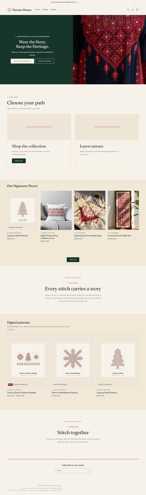
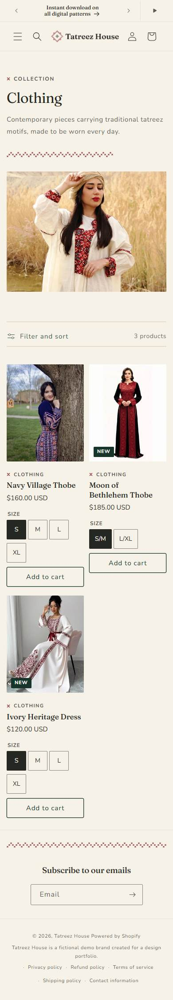

# Tatreez House | دار التطريز

A bilingual (English / Arabic) Shopify Online Store 2.0 theme for a Palestinian tatreez
(embroidery) brand: contemporary clothing, digital embroidery patterns, workshops and community
events, and learning content about motifs and technique.

> **Fictional demo brand.** Tatreez House is a portfolio project, not a real business. Products,
> prices and copy on the development store are demonstration content. No sales figures,
> testimonials or credentials are claimed.

## Features

- **Editorial design system** ("Editorial heritage"): Fraunces + Nunito (Latin), Amiri + Zain
  (Arabic), fluid type scale, 8 px spacing, 2 px radius, and an original cross-stitch graphic
  language (dividers, eyebrows, stitched link underline, woven linen surface).
  See [`docs/DESIGN_SYSTEM.md`](docs/DESIGN_SYSTEM.md).
- **Two clear paths** on the homepage: *Shop the collection* and *Learn tatreez*.
- **Product cards** with 4:5 media (uncropped charts for digital patterns), data-driven badges
  (Sale, Sold out, New, Instant download) and accessible quick add: one tap for single-variant
  products, option chips for multi-variant products, all through Dawn's cart drawer.
- **Collection hero**, clean filter toolbar, mobile filter drawer.
- **Header** with mega menu + featured card, pausable announcements, shrinking sticky header.
- **Product page** with shared option chips and a mobile sticky add to cart.
- **Footer** with stitch divider, mobile accordions and a demo-brand note.
- **Bilingual EN / AR** with RTL support throughout (`assets/rtl.css`).
- **Accessibility as acceptance criteria**: WCAG 2.2 AA contrast (checked by script), visible
  focus, keyboard-operable quick add and drawers, 44 px targets, reduced motion.

## Screenshots

Before / after pairs: [`docs/screenshots/m2/before-after.md`](docs/screenshots/m2/before-after.md).

| Home (desktop) | Collection (mobile) |
|---|---|
|  |  |

## Tech stack

- Shopify Online Store 2.0, based on **Dawn**
- Liquid, JSON templates, sections and snippets; vanilla CSS and JS (no build step)
- Shopify CLI for local development and theme checks
- Spec Kit (`.specify/`, `specs/`) for planning complex features
- Small Node and Python scripts for checks (`scripts/`)

## Architecture

```
layout/      theme.liquid (sets lang/dir, loads rtl.css for Arabic), password.liquid
sections/    Dawn sections + custom hero, path-cards, collection-hero, brand-story,
             workshops-teaser, learn-teaser
snippets/    Dawn snippets + theme-fonts, stitch-divider, editorial-split, card-badges,
             card-quick-add, card-variant-picker, mega-menu-feature, sticky-atc
templates/   JSON templates; index.json places the custom hero
assets/      Dawn CSS/JS + tatreez-tokens.css (design tokens), component/section CSS, small custom
             elements (card-quick-add, footer-accordion, sticky-atc), rtl.css, fonts.css.liquid,
             self-hosted WOFF2 fonts
locales/     en.default.json, en.default.schema.json, ar.json (full Arabic storefront)
config/      settings_schema.json, settings_data.json (pulled from the theme editor)
docs/        PROJECT_BRIEF.md, DECISIONS.md, fonts/
specs/       per-feature specifications (001-homepage-hero)
scripts/     contrast-check.mjs (WCAG pairs), capture-screens.py (screenshot matrix)
```

Conventions:
- Every merchant-facing value is a section or theme setting. Every string is a locale key.
- Colours come from the theme's colour schemes (`rgb(var(--color-foreground))`, …), never hex in custom CSS.
- New CSS uses logical properties (`margin-inline`, `text-align: start`, …). Dawn's own physical
  rules are mirrored for Arabic in one file, `assets/rtl.css`.

## Bilingual and RTL

- `layout/theme.liquid` sets `dir="rtl"` for the Arabic locale and loads `rtl.css` only there.
- `locales/ar.json` translates every storefront key, with all six Arabic plural forms.
- Hero position and alignment settings use `start / center / end`, so they mirror automatically.

## Fonts and licences

All fonts are SIL Open Font License 1.1, self-hosted and scoped with `unicode-range`:

| Role | Family |
|---|---|
| Latin headings, display | Fraunces |
| Latin body, UI | Nunito |
| Arabic body, UI | Zain (Arabic subset) |
| Arabic headings | Amiri (Arabic subset) |
| Decorative accent (opt-in `.font-accent`) | Playwrite NZ Basic |

Sources, versions, subsetting commands, hashes and licence texts: [`docs/fonts/README.md`](docs/fonts/README.md).

## Local development

Requires [Shopify CLI](https://shopify.dev/docs/api/shopify-cli) and Node 18+.

```sh
# Serve the theme against the development theme (never the live theme)
shopify theme dev --store <your-store>.myshopify.com --theme <development-theme-id> \
  --theme-editor-sync --reconciliation-strategy keep-local

# Pull settings changed in the theme editor before editing locally
shopify theme pull --theme <development-theme-id> \
  --only config/settings_data.json --only "templates/*.json" --only "sections/*.json"

# Static checks
shopify theme check                 # expect 0 errors
node scripts/contrast-check.mjs     # WCAG contrast of every colour scheme
```

Never run `shopify theme publish` or `theme push --live` against the live theme.

### Permanent preview theme: pull before push

The unpublished theme "Tatreez House" is edited in the theme editor too, so its JSON is always
pulled and committed before code is pushed to it:

```sh
# 1. Pull the editor state and review it
shopify theme pull --store tatreez-house --theme <theme-id>   --only config/settings_data.json --only "templates/*.json" --only "sections/*.json"
git diff                            # commit editor changes before anything else

# 2. Push code + JSON to the same unpublished theme (never --live, never publish)
shopify theme push --store tatreez-house --theme <theme-id>
```

The first time only: `shopify theme push --store tatreez-house --unpublished` creates it; record the
theme ID in [`docs/DECISIONS.md`](docs/DECISIONS.md).

### Acceptance tests

Playwright (Python) with Microsoft Edge, against `shopify theme dev` or a preview URL:

```sh
python -X utf8 scripts/tests/hero_slideshow_test.py http://127.0.0.1:9393 out/hero
python -X utf8 scripts/tests/cards_grids_test.py   http://127.0.0.1:9393 out/cards
python -X utf8 scripts/tests/keyboard_test.py      http://127.0.0.1:9393 out/kbd
python -X utf8 scripts/tests/wired_screens_test.py http://127.0.0.1:9393 docs/screenshots/m2/wired
```

What is still untested is tracked in [`specs/m2-wiring-untested.md`](specs/m2-wiring-untested.md).

## Product reviews

The theme shows ratings only from Shopify's **standard metafields** `reviews.rating` and
`reviews.rating_count`, which review apps such as **Judge.me** write. Without data, cards show
nothing and the product page shows "No reviews yet". To add reviews: install Judge.me (free plan),
then add its review widget as an **app block** in the product template (Customize → Product →
Add block → Apps). Never import or create fake reviews.

## Roadmap

| Milestone | Scope | Status |
|---|---|---|
| 001 | Custom homepage hero section | Done |
| M0 | Foundation: licensed fonts, colour check, full Arabic locale, hero on homepage, RTL fixes, docs | Done (owner admin actions pending) |
| M1 | Homepage "two paths" (Shop / Learn) | Done (delivered with M2) |
| M2 | Design system and UX overhaul: tokens, Fraunces, header/mega menu, product cards with quick add, collection hero, homepage story sections, footer, sticky add to cart | Done (admin menus and images pending) |
| M2.1 | Wiring and verification: hero slideshow, always-visible card actions + quick add in every grid, swatch colour map, minimal footer, header/homepage wiring on the new store, acceptance suites | Done (permanent theme push and images pending) |
| M3 | Garment product template (metafields); digital pattern template | Planned |
| M4 | Pattern library (`motif` metaobjects, filtering) | Planned |
| M5 | Workshops (products as events) and free community circles; Learn hub, blog and article templates | Planned |
| M6 | Accessibility/performance audit on production, owner handoff guide, case study | Planned |

Decisions and their reasons: [`docs/DECISIONS.md`](docs/DECISIONS.md). Full brief:
[`docs/PROJECT_BRIEF.md`](docs/PROJECT_BRIEF.md).

## Credits

Built on [Dawn](https://github.com/Shopify/dawn) by Shopify (see the Dawn repository for its licence). Fonts by the Nunito, Zain,
Amiri and Playwrite project authors (SIL OFL 1.1).
