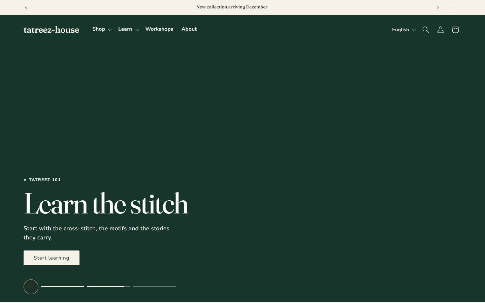
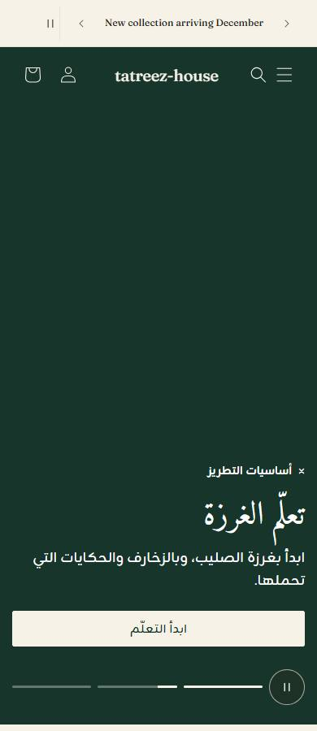
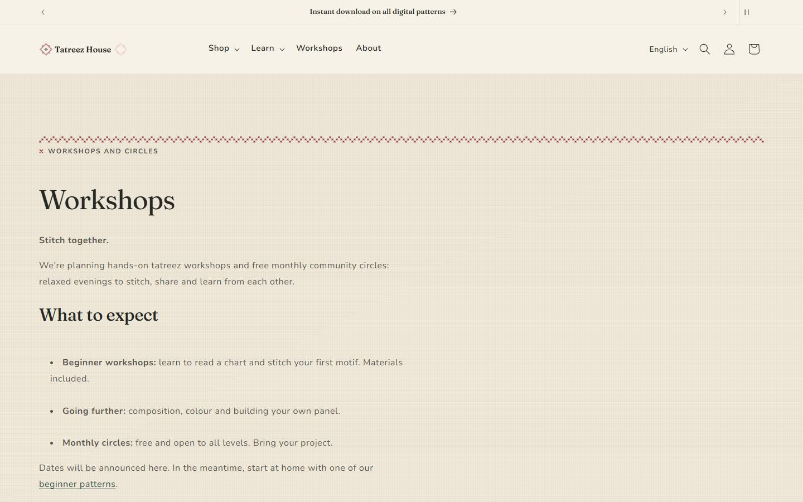
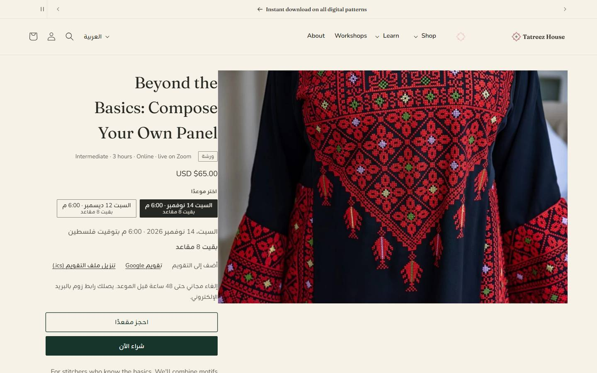

# Tatreez House | دار التطريز

A bilingual (English / Arabic, full RTL) Shopify Online Store 2.0 theme for a Palestinian tatreez
(cross-stitch embroidery) brand: contemporary clothing and home textiles, digital embroidery
patterns, workshops, and learning content about motifs and technique.

> **Fictional demo brand.** Tatreez House is a portfolio project, not a real business. Products,
> prices and copy are demonstration content. No sales figures, reviews, testimonials or
> credentials are claimed.

| Home, desktop (English) | Home, phone (Arabic, RTL) |
|---|---|
|  |  |

## Highlights

- **Editorial design system.** Fraunces + Nunito for Latin, Amiri + Zain for Arabic, a fluid
  type scale, design tokens in one file, and an original cross-stitch graphic language
  (stitched dividers, eyebrows and link underlines). See [`docs/DESIGN_SYSTEM.md`](docs/DESIGN_SYSTEM.md).
- **Full-bleed hero slideshow** with a transparent header, segmented progress, pause on hover,
  focus or button, arrow keys, reduced-motion and no-JavaScript fallbacks. A CSS animation drives
  the timer, with no slideshow library.
- **Product cards that behave the same everywhere.** An always-visible action on one baseline
  per row: "Add to cart" for single-variant products, "Choose options" opens a quick-add modal,
  "Sold out" is disabled. Quick add works in every grid, including search, related products and
  after filtering. Colour dots come from a merchant-editable palette, and ratings come only from
  real review data.
- **Mobile-first grids:** one column on small phones and two from 480 px, plus swipeable
  homepage rows that show the next card.
- **Header and mega menu** with a featured collection card; minimal footer with newsletter,
  language selector and policy links.
- **Bilingual EN / AR.** Every storefront string is translated, including the six Arabic plural
  forms. Empty text settings fall back to translated defaults, so Arabic pages never show
  hard-coded English.
- **Merchant-editable throughout.** Every value is a section or theme setting, and the theme
  editor is kept in sync with the repository (pull before every push).

## Events & workshops

People can book paid online workshops and reserve a free spot in the monthly stitch circle, with
no booking app: each workshop is a product, each **date is a variant**, **seats are inventory**,
and free circles go through a $0 checkout. The owner adds a date in under a minute
([`docs/OWNER_GUIDE.md`](docs/OWNER_GUIDE.md)).

- **Workshops page:** every upcoming session from the events collection, sorted by date, with
  a stitched date tile, type, level · duration · format, price or "Free", and real seats left.
  Filters (All / Workshops / Community circles) are shareable links. When there are no dates,
  the page offers the newsletter instead of fake dates. It also has "How booking works" steps
  and an FAQ, all editable.
- **Workshop page:** upcoming dates as chips (sold-out dates disabled as "Fully booked"),
  "Book a seat" or "Reserve my free spot", add to calendar (Google Calendar, `.ics`), what's
  included and what to bring from product metafields.
- **Everywhere:** cards show the next date and "From $45" / "Free"; the cart shows the formatted
  date; the homepage shows the next two sessions. Dates are written per language (Arabic weekday
  and month names) and always say "Palestine time" / "بتوقيت فلسطين".

| Workshops page (English) | Workshop page (Arabic) |
|---|---|
|  |  |

Why products instead of a booking app, and the time zone rule: [`docs/DECISIONS.md`](docs/DECISIONS.md) (M4).

## Quality and verification

Accessibility (WCAG 2.2 AA) and behaviour are acceptance criteria, checked against the real store:

| Check | Result |
|---|---|
| Hero slideshow suite (autoplay, pause, keyboard, reduced motion, no-JS, alignment 360–1920 px, EN + `/ar`) | 33 / 33 |
| Cards and grids suite (baselines, add to cart, quick-add modal focus trap, mobile columns, carousels, quick add in every grid) | 40 pass, 1 skipped (needs a sold-out product; passed when one existed) |
| Keyboard suite (skip link, mega menu, focus indicators, drawer, language selector) | 12 / 12 |
| Layout suite (4 pages × 6 widths × EN / AR: no horizontal scroll, correct direction, one h1) | 50 / 50 |
| Events suite (sorting, past dates, filters with and without JS, seats, empty state, date chips, calendar links, `.ics`, booking, Buy it now, $0 checkout, EN + `/ar`, 360–1440 px, keyboard booking) | 39 / 40 (the $0 checkout passed in a separate run; see `specs/m4-events-untested.md`) |
| Lighthouse accessibility (home, collection, product, Arabic home; live store) | 100 |
| `shopify theme check` | 0 errors |

Mobile performance is measured but not yet tuned: Lighthouse scores 30–59 on the live store, with
main-thread blocking as the main cost. That work is planned for milestone M7. Open items and their
reasons are listed in [`specs/m2-wiring-untested.md`](specs/m2-wiring-untested.md) and
[`specs/m4-events-untested.md`](specs/m4-events-untested.md).

## Screenshots

- [`docs/screenshots/m2/wired/`](docs/screenshots/m2/wired): home, collection, product and
  page at 360 / 390 / 430 / 768 / 1440 / 1920 px in English and Arabic, plus the mega menu and footer
- [`docs/screenshots/m2/hero-slideshow/`](docs/screenshots/m2/hero-slideshow) and
  [`docs/screenshots/m2/cards/`](docs/screenshots/m2/cards)
- Before and after the design overhaul: [`docs/screenshots/m2/before-after.md`](docs/screenshots/m2/before-after.md)

The storefront runs on a password-protected Shopify development store.

## Tech stack

- Shopify Online Store 2.0, based on **Dawn**
- Liquid, JSON templates, sections and snippets; vanilla CSS and small custom elements (no build step)
- Shopify CLI (theme dev, pull/push, theme check) and the Shopify AI Toolkit Liquid validator
- Playwright (Python) acceptance suites; Lighthouse; Node and Python helper scripts

## Architecture

```
layout/      theme.liquid (lang/dir, rtl.css for Arabic), password.liquid
sections/    Dawn sections + hero-slideshow, events-listing, path-cards, collection-hero, brand-story,
             workshops-teaser, learn-teaser, minimal footer
snippets/    Dawn snippets + event-date, event-session-keys, event-session-card, event-product-block,
             newsletter-form, card-quick-add, card-swatches, rating-stars, card-badges,
             mega-menu-feature, header-logo-over-hero, stitch-divider, editorial-split, sticky-atc
templates/   JSON templates
assets/      Dawn CSS/JS + tatreez-tokens.css (design tokens), component and section CSS,
             custom elements (hero-slideshow, card-quick-add, sticky-atc), rtl.css, self-hosted WOFF2
locales/     en.default.json, ar.json (full Arabic storefront), en.default.schema.json
config/      settings_schema.json, settings_data.json (synced with the theme editor)
docs/        PROJECT_BRIEF, DECISIONS, DESIGN_SYSTEM, fonts, screenshots, store-setup (rebuild kit)
specs/       feature specifications and the untested list
scripts/     tests/ (Playwright suites), validate-theme.sh, contrast-check.mjs
```

Conventions:
- Every merchant-facing value is a setting, and every string is a locale key.
- Custom CSS uses colour-scheme variables and tokens, never hex values.
- New CSS uses logical properties (`margin-inline`, `inset-inline-start`, …). Dawn's own
  physical rules are mirrored for Arabic in one file, `assets/rtl.css`.
- Store data (menus, pages, collections, images) is never hard-coded; it is documented in
  [`docs/store-setup/`](docs/store-setup) so the store can be rebuilt.

## Fonts and licences

All fonts are SIL Open Font License 1.1, self-hosted and scoped with `unicode-range`:

| Role | Family |
|---|---|
| Latin headings, display | Fraunces |
| Latin body, UI | Nunito |
| Arabic body, UI | Zain (Arabic subset) |
| Arabic headings | Amiri (Arabic subset) |
| Decorative accent (opt-in `.font-accent`) | Playwrite NZ Basic |

Sources, versions, subsetting commands, hashes and licence texts: [`docs/fonts/README.md`](docs/fonts/README.md).

## Local development

Requires [Shopify CLI](https://shopify.dev/docs/api/shopify-cli), Node 18+ and, for the tests,
Python with Playwright and Microsoft Edge.

```sh
# Local preview against a temporary development theme
shopify theme dev --store <your-store>

# Static checks
shopify theme check                 # expect 0 errors
node scripts/contrast-check.mjs     # WCAG contrast of every colour scheme
```

### The store theme: pull before push

The store theme "Tatreez House" is also edited in the theme editor (images, logo). Its editor
state is always pulled and committed before code is pushed:

```sh
# 1. Pull the editor state, review it, commit it
shopify theme pull --store <your-store> --theme <theme-id> \
  --only config/settings_data.json --only "templates/*.json" --only "sections/*.json"
git diff

# 2. Push code + JSON to the same theme
shopify theme push --store <your-store> --theme <theme-id>
```

The theme ID and its history are recorded in [`docs/DECISIONS.md`](docs/DECISIONS.md).

### Acceptance tests

```sh
python -X utf8 scripts/tests/hero_slideshow_test.py http://127.0.0.1:9393 out/hero
python -X utf8 scripts/tests/cards_grids_test.py   http://127.0.0.1:9393 out/cards
python -X utf8 scripts/tests/keyboard_test.py      http://127.0.0.1:9393 out/kbd
python -X utf8 scripts/tests/wired_screens_test.py http://127.0.0.1:9393 docs/screenshots/m2/wired
# Events: runs on the real store domain through a theme preview (the dev proxy can't reach checkout)
STORE_PW=... python -X utf8 scripts/tests/events_test.py unused out/events --preview-theme <theme-id>
```

## Product reviews

The theme shows ratings only from Shopify's **standard metafields** `reviews.rating` and
`reviews.rating_count`, which review apps such as **Judge.me** write. Without data, cards show
nothing and the product page shows "No reviews yet". To add reviews, install Judge.me, then add its
review widget as an **app block** in the product template. Never import or create fake reviews.

## Roadmap

| Milestone | Scope | Status |
|---|---|---|
| 001 | Custom homepage hero section | Done |
| M0 | Foundation: licensed fonts, colour check, full Arabic locale, RTL fixes, docs | Done |
| M1 | Homepage "two paths" (Shop / Learn) | Done (with M2) |
| M2 | Design system and UX: tokens, Fraunces, header/mega menu, product cards, collection hero, homepage story sections, sticky add to cart | Done |
| M2.1 | Hero slideshow, consistent card actions + quick add in every grid, swatch palette, minimal footer, store wiring, acceptance suites, live theme | Done |
| M3 | Garment product template (metafields); digital pattern template | Planned |
| M4 | Events: paid workshops and free monthly community circles (products as events), owner guide | Done |
| M5 | Pattern library (`motif` metaobjects, filtering) | Planned |
| M6 | Learn hub, blog and article templates | Planned |
| M7 | Performance and accessibility audit on production, owner handoff guide, case study | Planned |

Decisions and their reasons: [`docs/DECISIONS.md`](docs/DECISIONS.md). Full brief:
[`docs/PROJECT_BRIEF.md`](docs/PROJECT_BRIEF.md).

## Credits

Built on [Dawn](https://github.com/Shopify/dawn) by Shopify (see the Dawn repository for its
licence). Fonts by the Fraunces, Nunito, Zain, Amiri and Playwrite project authors (SIL OFL 1.1).
Some product and editorial photos visible in the screenshots are third-party placeholder images
used only on the demo store. They are not part of this repository.
